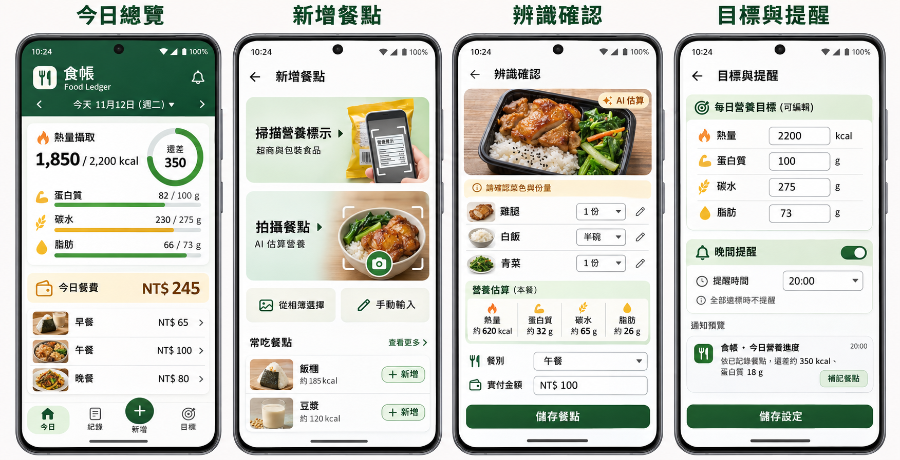
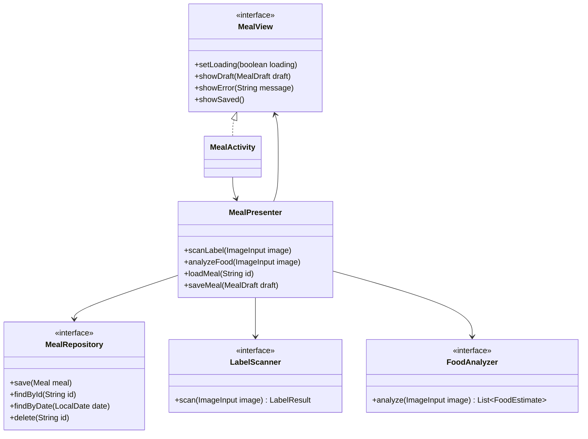
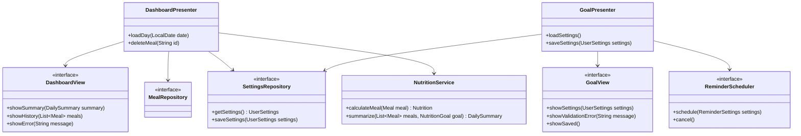
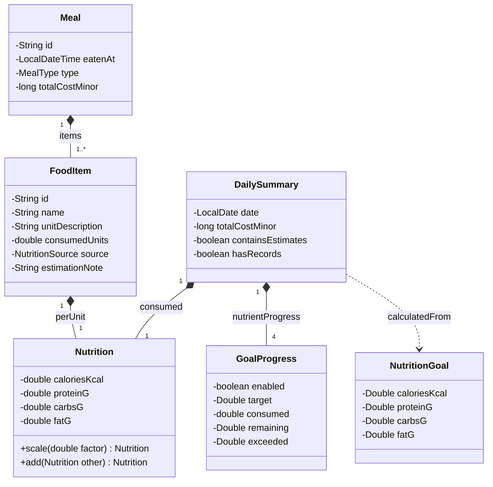
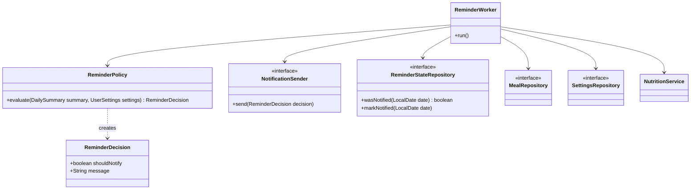
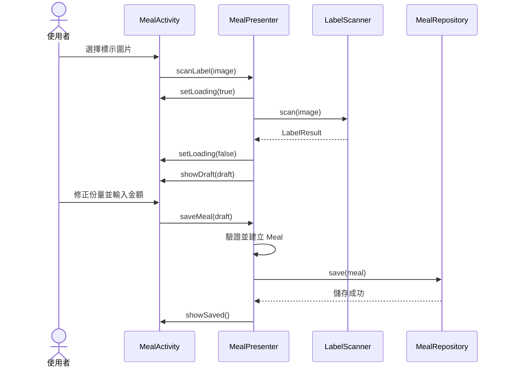

# 食帳 Food Ledger

一餐只記一次，同時追蹤每日營養攝取與餐費。

食帳是一個規劃中的 Android App，提供營養標示掃描、食物照片估算、餐費紀錄、自訂營養目標與晚間差額提醒。

> **專案狀態：規劃與設計階段。** 以下功能、類別與分工為預定設計，尚未代表已完成實作。專案由三人開發，Repository 建議命名為 `food-ledger`。

## 1. Motivation

外食者需要自行查詢食品營養、估計份量，並另外記錄餐費，重複輸入容易增加負擔。我們希望把同一餐的食物、營養與實付金額整合，讓使用者在選擇下一餐時知道已吃多少、還差多少，以及今天花了多少錢。

例如超商早餐包含飯糰和豆漿，使用者掃描營養標示、確認食用量並輸入整餐金額，就能更新營養與餐費紀錄。

## 2. Market

目標使用者為經常購買超商食品、便當或自助餐，且關注營養攝取與預算的大學生和上班族。已有查看營養標示習慣的人，可作為第一批試用對象。

產品價值在於降低記錄成本，並讓營養與餐費能共同查詢。市場需求仍待驗證，規劃邀請 5～8 位目標使用者試用，觀察記錄時間、修改次數、漏記情況，以及是否回頭查看紀錄。

## 3. Functions

| 功能 | 規劃內容 |
| --- | --- |
| 營養標示掃描 | 拍攝包裝標示，擷取熱量、蛋白質、碳水化合物、脂肪、基準份量與包裝份數 |
| 食物照片估算 | 由多模態大語言模型辨識菜色與估計份量，再結合營養資料產生可修改結果 |
| 辨識確認 | 使用者核對圖片、修正品名、份量及數值後才儲存 |
| 手動記餐 | 支援手動新增，以及修改或刪除既有餐點 |
| 餐費記錄 | 一餐包含多個品項，整餐輸入一次實付金額 |
| 每日總覽 | 顯示營養攝取、目標進度、剩餘或超出量及當日餐費 |
| 歷史紀錄 | 依日期查看餐點，沿用常吃餐點並修改份量或金額 |
| 每週回顧 | 彙整餐費與營養紀錄 |
| 自訂目標 | 可分別設定熱量與三大營養素，只追蹤有設定的項目 |
| 晚間提醒 | 自訂提醒時間，依當日最新紀錄顯示未達標差額 |

### 食用量換算

豆漿每份 200 mL、每瓶兩份，每份蛋白質 7 g。喝完整瓶記錄 14 g，喝半瓶記錄 7 g。每個品項都必須保存基準單位，避免混淆「每份」與「每 100 g／mL」。

### 晚間提醒規則

| 狀況 | 行為 |
| --- | --- |
| 關閉提醒或未設定任何目標 | 略過 |
| 當天完全沒有飲食紀錄 | 提醒補記 |
| 已設定項目全部達標 | 略過 |
| 仍有未達標項目 | 顯示各項剩餘量 |
| 紀錄包含照片估算 | 差額加上「約」 |
| 當日已發送提醒 | 避免重複發送 |

通知範例（數值為示意）：

> 依今天已記錄的餐點，距離你設定的目標還差約 350 kcal、蛋白質 18 g。

點選通知可查看紀錄或補記餐點。提醒依已記錄資料計算，使用者可以在補記後重新查看差額。

### 延伸功能

核心流程完成後，可加入「依預算從常吃餐點找選項」，例如查詢過去吃過、低於 100 元的餐點，並依蛋白質排序。此功能列為延伸範圍。

## 4. Challenges

| 挑戰 | 處理方向 | 評估方式 |
| --- | --- | --- |
| 標示欄位配對 | 區分每份與每 100 g，保留原圖供核對 | 欄位辨識與份量換算正確率 |
| 食物份量與隱藏用料 | 允許修正份量，保存估算依據 | 已知重量餐點的估算誤差 |
| 記錄負擔 | 整餐輸入一次金額，支援常吃餐點 | 記錄時間、修改次數、漏記餐數 |
| 資料一致性 | 餐點與品項一起儲存，修改後重新計算摘要 | 新增、修改、刪除後數值一致 |
| 非同步失敗 | 處理辨識逾時、格式錯誤、儲存失敗與重試 | 失敗後可繼續編輯，避免重複儲存 |
| 提醒可靠性 | 執行時讀取最新設定，保存當日提醒狀態 | 達標、漏記、設定變更及重複執行情境 |

## 5. GUI 規劃

介面圖片為設計草稿，數值、日期與部分文字僅供示意。圖片位於 `docs/images/gui-preview.png`，上傳 GitHub 時請保留此相對路徑。

採深綠主色、淺色卡片與琥珀色提示，照片估算結果明確標記來源。

| 畫面 | 主要內容 |
| --- | --- |
| 今日總覽 | 日期切換、熱量與營養進度、當日餐費、餐點清單 |
| 新增餐點 | 掃描標示、拍攝餐點、相簿選圖、手動輸入、常吃餐點 |
| 辨識確認 | 圖片預覽、菜色與份量修改、營養摘要、餐別與實付金額 |
| 目標與提醒 | 每項目標的啟用與數值、提醒開關、時間、通知預覽 |
| 歷史紀錄 | 按日期查看、編輯、刪除與沿用餐點 |

主要流程為「新增餐點 → 辨識確認 → 儲存 → 更新今日總覽」。手動輸入及沿用歷史餐點也使用相同的編輯與儲存流程。

## 6. MVP 架構

| 層級 | 責任 | 類別 |
| --- | --- | --- |
| View | 顯示資料、取得使用者操作與 Android 圖片輸入 | Activity、Fragment、View 介面 |
| Presenter | 協調非同步流程、驗證輸入、更新載入與錯誤狀態 | MealPresenter、DashboardPresenter、GoalPresenter |
| Model | 資料物件、營養計算、資料存取與辨識服務 | Meal、Repository、NutritionService、Scanner、Analyzer |

Presenter 透過 View 介面更新畫面，透過 Repository 和辨識介面取得資料。依賴由建構子傳入，開發時可換成假實作。

下列 UML 為概念類別圖。非同步方法的 callback／Future 等語法省略，程式語言、資料庫、辨識服務及排程方案待團隊確認。

### 記餐流程類別圖

辨識結果先形成 `MealDraft`，使用者確認後再建立正式 `Meal`。編輯既有餐點時保留原 ID，儲存更新原紀錄。辨識或儲存失敗時保留草稿，讓使用者修正或重試。

### 首頁與設定類別圖

`DashboardFragment` 實作 `DashboardView`，`GoalActivity` 實作 `GoalView`。修改餐點或返回首頁時重新載入摘要；修改提醒時間時更新原排程。

### 核心資料類別圖

- `Meal` 表示整餐，`FoodItem` 表示該餐實際吃下的品項。
- `perUnit` 搭配 `unitDescription` 保存基準營養，例如「每份 200 mL」。
- 品項攝取量為基準營養乘上 `consumedUnits`，整餐再加總各品項。
- `Nutrition.scale()` 和 `add()` 回傳新物件，避免修改基準值。
- `NutritionSource` 包含 `LABEL`、`PHOTO_ESTIMATE`、`MANUAL`。
- 目標空值代表未設定。`GoalProgress` 區分未啟用、未達標、達標與超出。
- 目標啟用時，剩餘量為 `max(target - consumed, 0)`，超出量為 `max(consumed - target, 0)`。
- 金額使用整數與固定最小貨幣單位；是否只支援整數新臺幣，開發前統一。
- 缺少的營養數值必須經確認或補填，不能把辨識缺值直接當成零。

### 中間資料與設定

| 類別 | 內容 |
| --- | --- |
| MealDraft | 尚未完成的餐別、日期、品項、金額，以及編輯時的原紀錄 ID |
| ImageInput | 圖片來源的封裝 |
| LabelResult | 標示數值、單位、包裝份數與待確認欄位 |
| FoodEstimate | 食材名稱、估計份量、營養值與估算說明 |
| UserSettings | NutritionGoal、ReminderSettings 與貨幣設定 |
| ReminderSettings | 提醒開關與本地提醒時間 |

### 背景提醒類別圖

背景工作執行時重新讀取設定與當日餐點，沿用 `NutritionService` 計算差額。`ReminderPolicy` 判斷通知內容，`NotificationSender` 顯示通知。當日提醒狀態需持久化，搭配固定的當日通知識別及工作去重，處理重試或並行執行。日期與提醒時間採使用者本地時區。

### 記餐互動流程

非同步實作需讓失敗路徑同樣結束載入狀態，並避免畫面離開後更新失效的 View。連續點擊儲存、重試及編輯操作應維持同一筆紀錄的識別。

## 7. 三人分工

| 成員 | 責任 | 主要交付 |
| --- | --- | --- |
| A | 畫面與 Android 整合 | Activity／Fragment、View 介面實作、拍照與選圖、提醒排程、Worker、通知 |
| B | Presenter 與核心資料 | 三個 Presenter、餐點與設定物件、Repository 實作、營養計算、提醒規則及提醒狀態保存 |
| C | 標示與食物辨識 | LabelScanner、FoodAnalyzer、辨識結果格式、份量與欄位解析、辨識評測 |

共同先定義餐點格式、營養及金額單位、非同步回傳與錯誤格式。A 可用假資料製作畫面，B 可用假辨識服務串接流程，C 可獨立用圖片評測。整合、實機驗證與期末展示由三人共同完成。

## 8. 開發順序

- [ ] 統一資料類別、介面、單位、語言與技術選型。
- [ ] 完成手動記餐、儲存與每日摘要。
- [ ] 完成目標設定與進度計算。
- [ ] 以假辨識結果串通草稿確認流程。
- [ ] 接入營養標示掃描與份量換算。
- [ ] 接入食物照片估算與修正流程。
- [ ] 完成歷史修改、刪除與常吃餐點沿用。
- [ ] 完成晚間提醒、漏記處理與重複通知防護。
- [ ] 完成週回顧、使用者試用與整合驗證。

## 9. 驗收與展示

| 情境 | 預期結果 |
| --- | --- |
| 掃描豆漿並選擇兩份 | 營養正確乘上兩份 |
| 將白飯從一碗改為半碗 | 草稿與儲存後的摘要同步反映 |
| 修改或刪除餐點 | 今日營養及餐費重新計算 |
| 只設定蛋白質目標 | 其餘未設定項目不參與達標判斷 |
| 當日無紀錄 | 提醒補記 |
| 全部目標達成 | 略過差額通知 |
| 辨識或儲存失敗後重試 | 草稿保留，成功後只有一筆紀錄 |
| 工作重複執行 | 避免重複通知 |

展示建議使用超商早餐與便當午餐，依序呈現標示掃描、照片估算、份量修改、金額輸入、每日摘要與晚間差額通知。

## 10. 技術選型與執行方式

目前尚未確認程式語言、Android SDK 版本、建置設定、資料庫、OCR 套件、模型供應商及營養資料來源。建立 Android 專案後，再補上實際環境需求、設定方式與可執行的建置指令。

介面設計允許先使用假 Repository 和假辨識服務完成主要操作流程，再換成正式實作。

